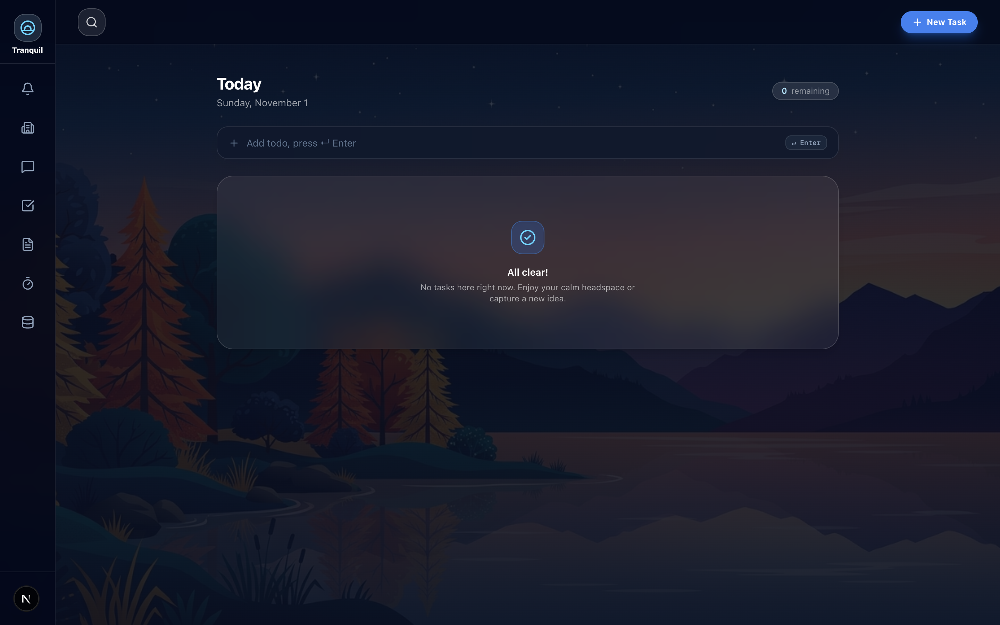
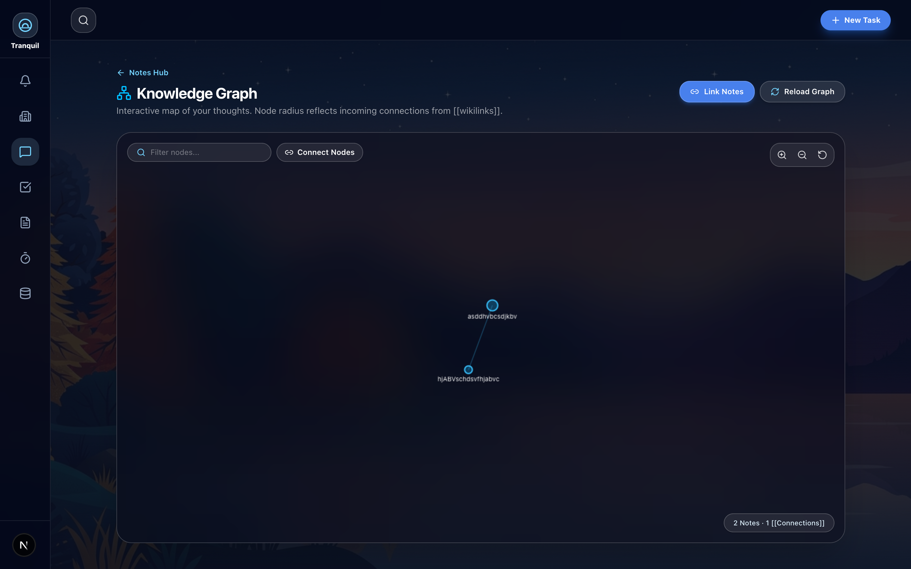
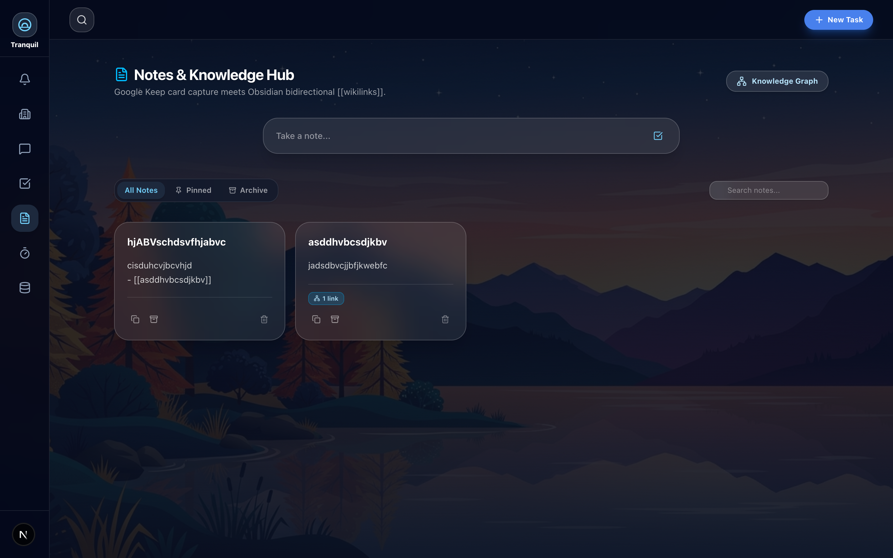
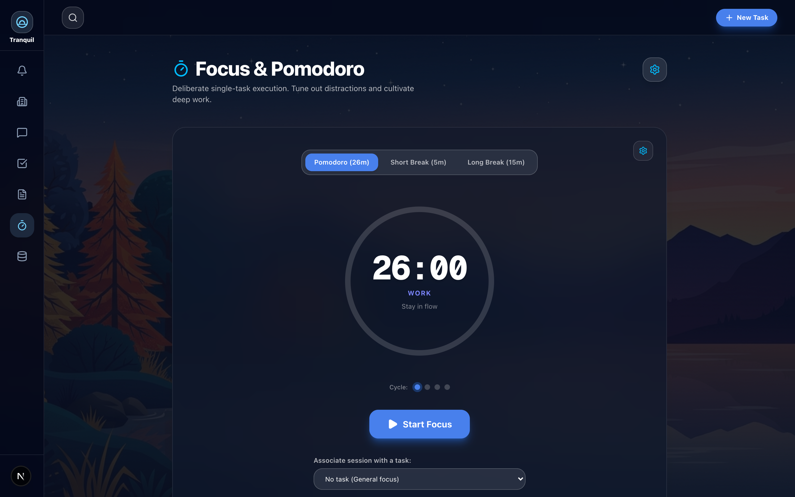
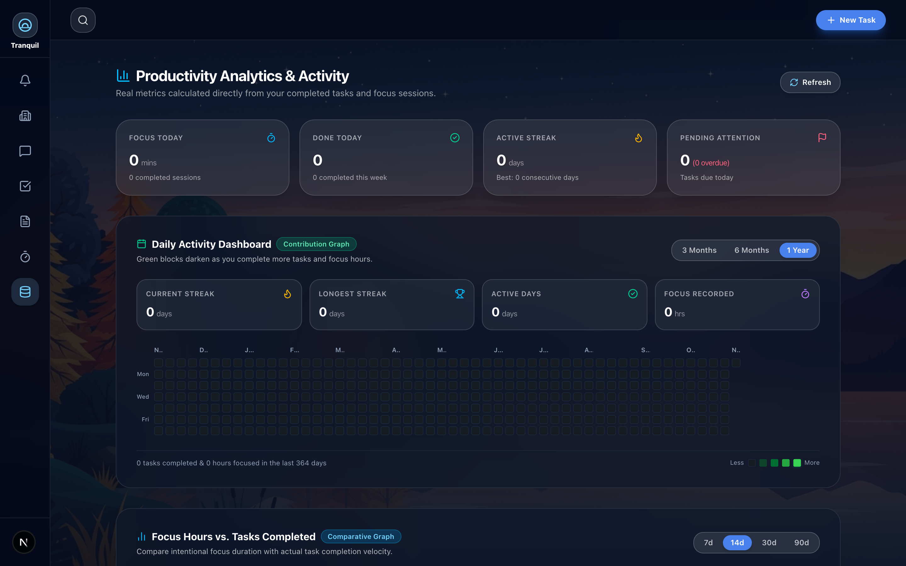
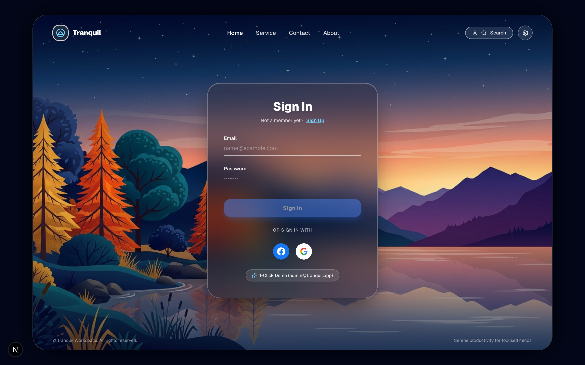

# Tranquil 🌿

> An elegant, all-in-one productivity platform uniting notes, tasks, projects, interactive knowledge graphs, and Pomodoro focus tracking.

[](https://nextjs.org/)
[](https://react.dev/)
[](https://tailwindcss.com/)
[](https://www.djangoproject.com/)
[](https://www.django-rest-framework.org/)

---



---

## ✨ Features

- 📝 **Smart Notes**: Rich note editor with tagging, pinning, custom color palettes, and bidirectional note linking.
- 🕸️ **Interactive Knowledge Graph**: Obsidian-style graph visualization connecting your thoughts and notes in real time.
- 🎯 **Task Management**: Todoist-inspired Inbox, Today, Upcoming, and custom Project views with priority matrix and tags.
- ⏳ **Pomodoro Focus Timer**: Customizable work/break intervals, ambient soundscapes (rain, coffee shop, white noise), and streak tracking.
- 📊 **Productivity Analytics**: Github-style activity heatmaps, focus vs. task completion metrics, and deep weekly trends.
- ⚡ **Modern Stack**: Built with Next.js 16 (Turbopack, Partial Prerendering) and Django REST Framework (JWT Authentication).

---

## 📸 Screenshots & Showcase

### 1. Daily Dashboard & Focus Center
Keep track of today's schedule, priority tasks, mini calendar, and analog clock in one unified space.


### 2. Interactive Knowledge Graph
Explore relationships between your notes, thoughts, and ideas with force-directed physics.


### 3. Connected Smart Notes
Organize knowledge cards with tag filtering, color categorization, and bi-directional links.


### 4. Pomodoro Focus Timer
Enter deep work with customizable Pomodoro intervals, session counters, and ambient background sounds.


### 5. Productivity & Focus Analytics
Visualize completion consistency with activity heatmaps and focus vs. task completion correlation.


### 6. Authentication & Onboarding
Clean, secure sign-in and account registration powered by JWT authentication and HTTP-only cookies.


---

## 🏗️ Project Structure

```text
├── frontend/             # Next.js 16 + React 19 Frontend
│   ├── app/              # App Router pages (Today, Inbox, Notes, Focus, etc.)
│   ├── components/       # UI components & widgets
│   ├── lib/              # API clients & contexts
│   └── public/           # Static assets & audio
├── backend/              # Django REST Framework Backend
│   ├── apps/             # Modular Django apps (accounts, notes, tasks, etc.)
│   ├── tranquil/         # Project settings & configuration
│   └── manage.py         # Django CLI
├── docs/screenshots/     # High-resolution application screenshots
└── .gitignore            # Git ignore rules for Python & Node
```

---

## 🚀 Getting Started

### 1. Frontend (Next.js)

```bash
cd frontend
npm install
npm run dev
```

The frontend will be available at `http://localhost:3000`.

### 2. Backend (Django)

```bash
cd backend
python -m venv venv
source venv/bin/activate  # On Windows: venv\Scripts\activate
pip install -r requirements/development.txt
python manage.py migrate
python seed_demo_data.py   # Seeds demo user (admin@tranquil.app / Password123!)
python manage.py runserver 8001
```

The backend API will run on `http://localhost:8001/api/v1/`.

---

## 🌐 Deploy to Vercel

The frontend is ready for immediate deployment on [Vercel](https://vercel.com):

1. Go to [Vercel Dashboard](https://vercel.com/new).
2. Import repository **`Yuvansh-thx/tranquil-app`**.
3. Under **Root Directory**, click **Edit** and select **`frontend`**.
4. Set the environment variable:
   - `NEXT_PUBLIC_API_URL`: Your deployed backend API URL (or production API server).
5. Click **Deploy**.

---

## 📄 License

MIT
